# Part 1: Database Server

Our database, `restaurants`, is hosted at `35.245.147.165` and runs MySQL
`8.4.11-google`. Connections use TLS with `--ssl-mode=REQUIRED`.
All 16 tables use InnoDB.

\newpage

# Part 2: Table Schemas

## Final E-R Diagram

We kept the Milestone 1 design and all 16 tables. The E-R diagram is unchanged.

```{=latex}
\includepdf[pages=-, landscape=true]{"./media/Milestone1ER.pdf"}
```

## Final Normalized Schemas (Unchanged)

User($\underline{\text{user\_id}}$, display_name, email, password_hash, joined_at)

Vendor($\underline{\text{vendor\_id}}$, name, description, vendor_type, phone_number, website_url, listing_status, created_at, timezone, submitted_by_user_id)

Cuisine($\underline{\text{cuisine\_id}}$, cuisine_name)

Location($\underline{\text{location\_id}}$, location_name, street_address, city, state, postal_code, latitude, longitude)

OperatingStop($\underline{\text{stop\_id}}$, vendor_id, location_id, scheduled_start, scheduled_end, actual_start, actual_end, stop_status, notes)

OperatingHours($\underline{\text{vendor\_id}}$, $\underline{\text{hours\_number}}$, day_of_week, opening_time, closing_time)

MenuItem($\underline{\text{menu\_item\_id}}$, vendor_id, item_name, description, price, category, availability_status)

Review($\underline{\text{review\_id}}$, author_user_id, vendor_id, rating, review_text, created_at, updated_at)

Photo($\underline{\text{photo\_id}}$, uploader_user_id, vendor_id, image_url, caption, uploaded_at)

FoodPermit($\underline{\text{permit\_id}}$, vendor_id, permit_number, issuing_authority, permit_type, issued_date, expiration_date, document_url)

Manages($\underline{\text{user\_id}}$, $\underline{\text{vendor\_id}}$, management_role, granted_at)

Favorites($\underline{\text{user\_id}}$, $\underline{\text{vendor\_id}}$, saved_at)

VendorCuisine($\underline{\text{vendor\_id}}$, $\underline{\text{cuisine\_id}}$)

VendorBase($\underline{\text{vendor\_id}}$, location_id)

ReviewPhoto($\underline{\text{photo\_id}}$, review_id)

MenuItemPhoto($\underline{\text{photo\_id}}$, menu_item_id)

## Implementation Decisions

- Primary and foreign keys follow the Milestone 1 relationships.
- OperatingHours uses weekday names and allows multiple shifts per day through
  its `(vendor_id, hours_number)` key.
- Average ratings and review counts are calculated from reviews.
- Imported authors have anonymous profiles, placeholder emails, and disabled
  password markers. Demo accounts use bcrypt password hashes.
- Imported listings belong to the Dataset Importer profile. Management access
  is recorded separately in Manages.
- Timestamps use UTC, while weekly opening hours use local time. Coordinates
  are rounded to six decimal places.

## Table Schema and Row-Count Screenshots

These screenshots show `DESC` and the row count for each of the 16 tables.

### User

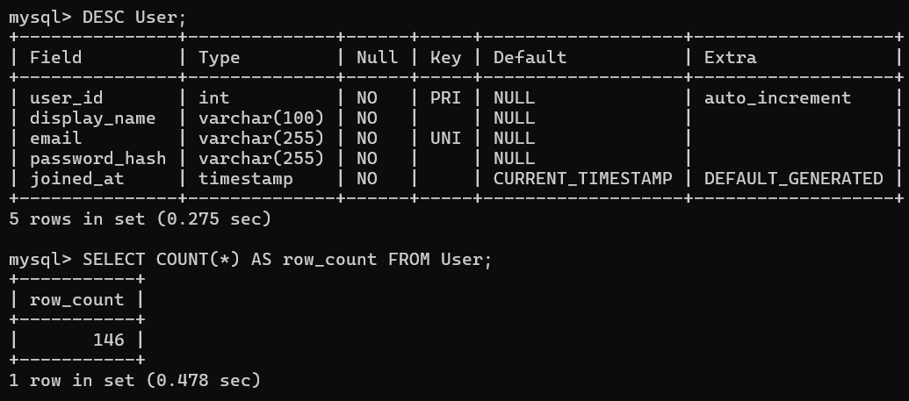{width=100% fig-pos="H"}

### Vendor

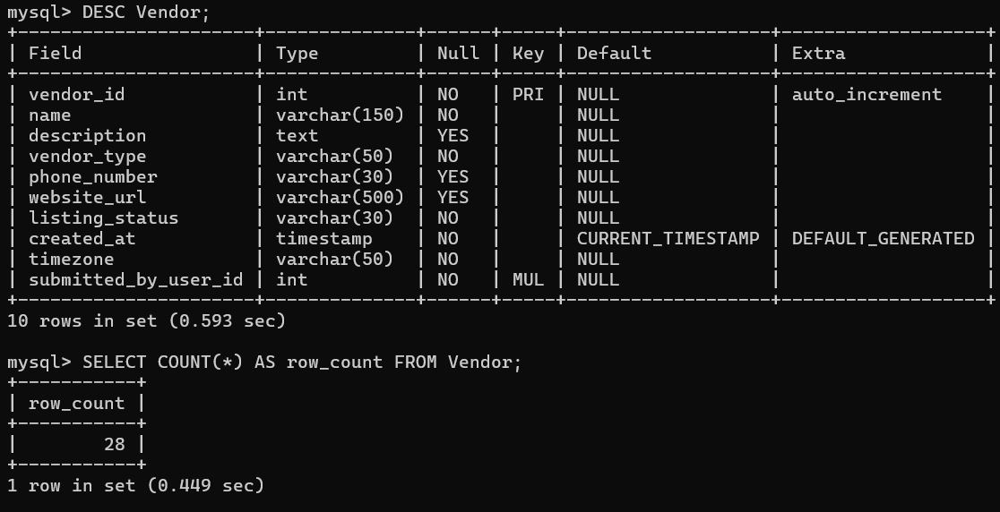{width=100% fig-pos="H"}

### Cuisine

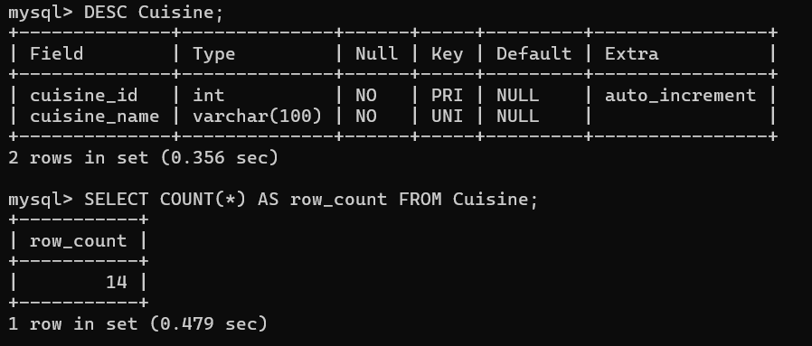{width=100% fig-pos="H"}

### Location

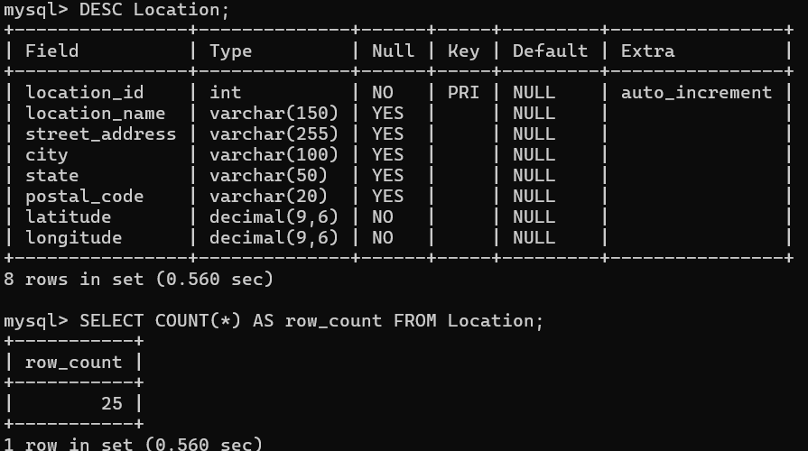{width=100% fig-pos="H"}

### OperatingHours

```{=latex}
\begin{landscape}
```

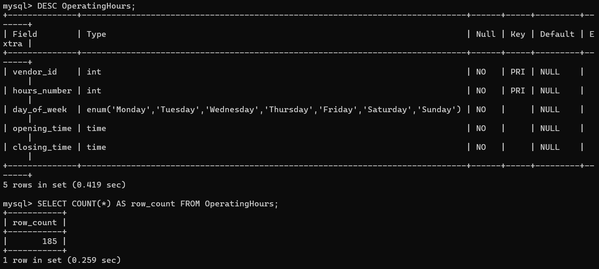{width=100% fig-pos="H"}

```{=latex}
\end{landscape}
```

### OperatingStop

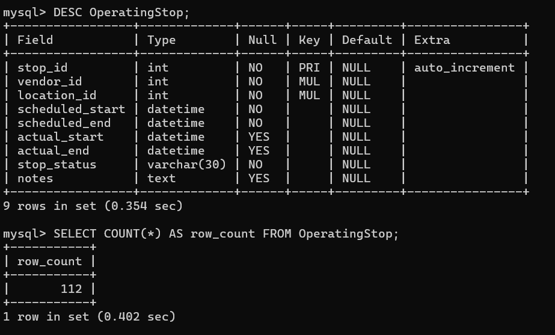{width=100% fig-pos="H"}

### MenuItem

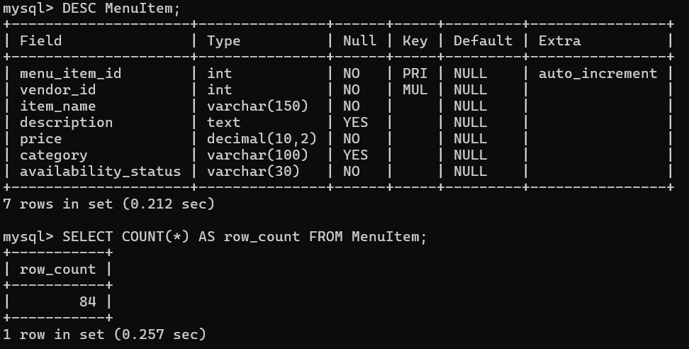{width=100% fig-pos="H"}

### Review

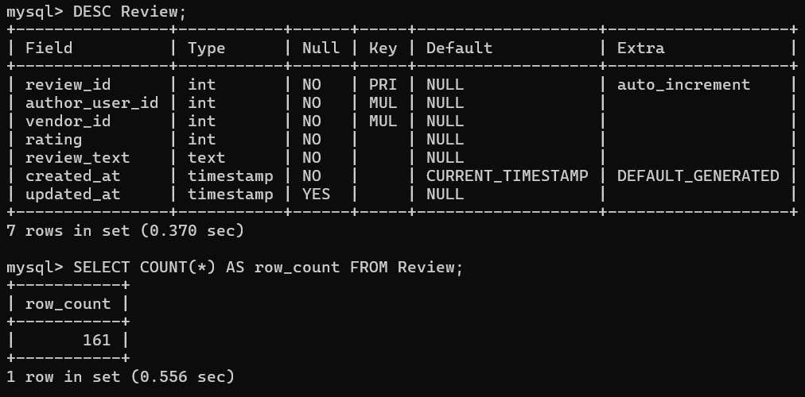{width=100% fig-pos="H"}

### Photo

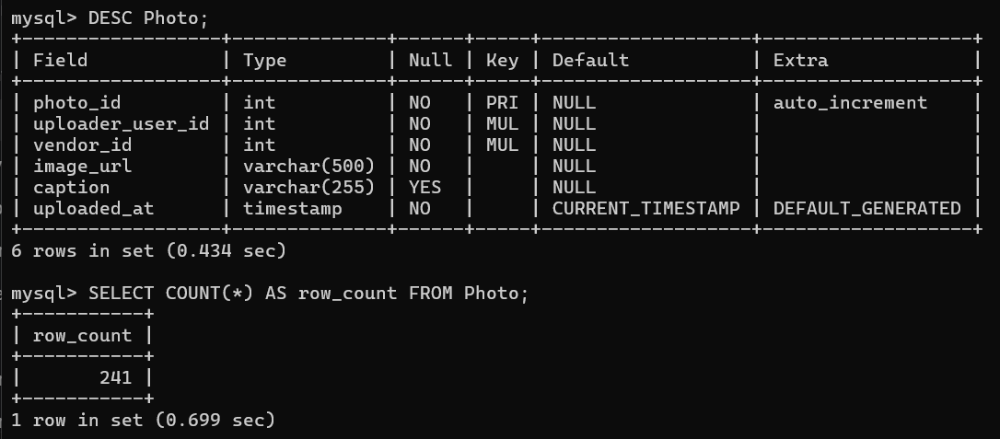{width=100% fig-pos="H"}

### FoodPermit

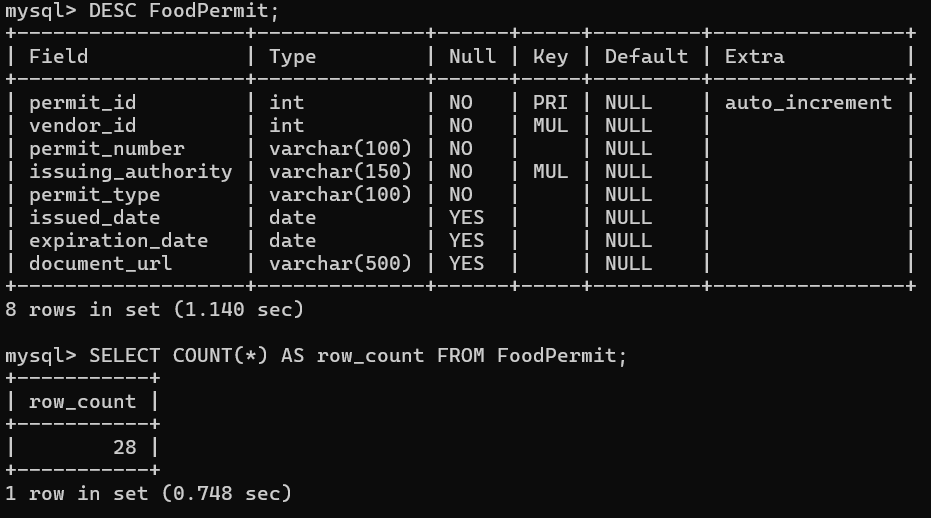{width=100% fig-pos="H"}

### Manages

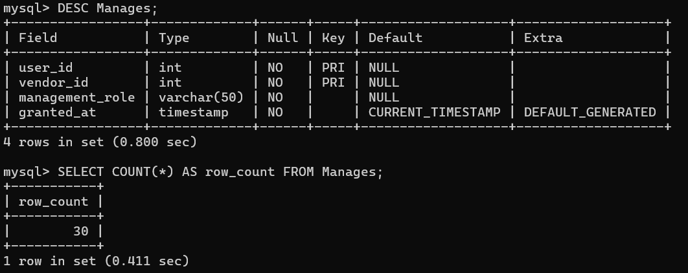{width=100% fig-pos="H"}

### Favorites

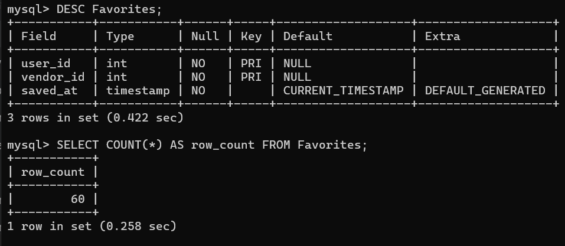{width=100% fig-pos="H"}

### VendorCuisine

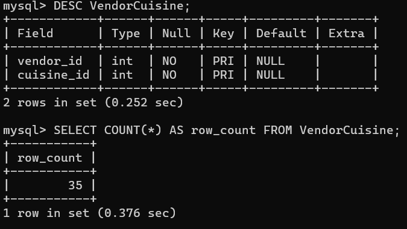{width=100% fig-pos="H"}

### VendorBase

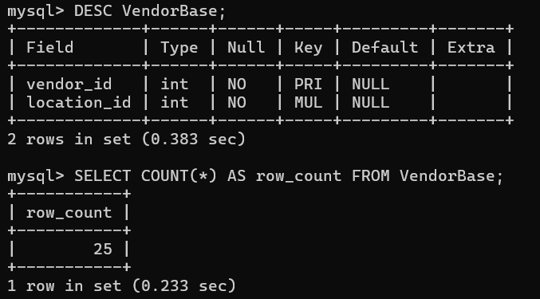{width=100% fig-pos="H"}

### ReviewPhoto

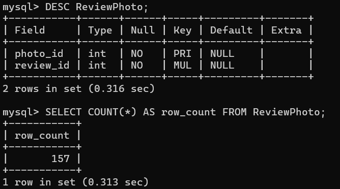{width=100% fig-pos="H"}

### MenuItemPhoto

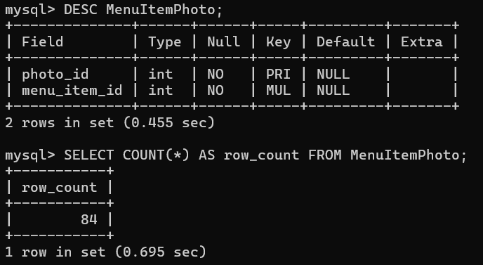{width=100% fig-pos="H"}

\newpage

# Part 3: Dataset and Population

## Sources and Preparation

We used UCSD's **Google Local Data (2021)**, specifically the Virginia business
metadata and 10-core reviews, instead of the proposal's suggested Yelp dataset.
Python filtered food businesses, matched reviews by `gmap_id`, and split the
records into our tables. Source IDs were mapped to database IDs to keep the
relationships connected.

The dataset contains **25 real businesses and 3 fictional mobile/pop-up vendors**.
The imported information is historical. We loaded the data using 16 multi-row
INSERT statements, with referenced records added before dependent records.

## Real and Synthetic Data

The dataset includes **105 real reviews and 56 labeled demo reviews**. Real
review text and ratings are preserved. Imported authors are anonymized and
have placeholder emails because they did not register for our app.

Business details, locations, cuisines, and weekly hours come from the source
where available. Menu items, prices, permits, managers, favorites, and dated
operating stops are synthetic. Missing schedules and contact details use demo
placeholders. Fictional content is labeled in the records.

Generic menu photos come from TheMealDB and are illustrations. Permit numbers
starting with `DEMO-NOT-VALID` are fictional. Unknown optional values, including
permit documents and actual times for future stops, remain NULL.

## Row Counts and Practical Coverage

These counts were checked against the database and stayed unchanged after the rolled-back tests.

| Table | Rows |
|---|---:|
| User | 146 |
| Vendor | 28 |
| Cuisine | 14 |
| Location | 25 |
| OperatingHours | 185 |
| OperatingStop | 112 |
| MenuItem | 84 |
| Review | 161 |
| Photo | 241 |
| FoodPermit | 28 |
| Manages | 30 |
| Favorites | 60 |
| VendorCuisine | 35 |
| VendorBase | 25 |
| ReviewPhoto | 157 |
| MenuItemPhoto | 84 |

Each vendor has three menu items and four dated stops. Twelve demo customers
each have five favorites. Vendors share cuisine labels, reviews link to authors,
and photos link to reviews and menu items. The three mobile vendors also give
us examples without a permanent base location.

These records let us test searches, profiles, reviews, menus, schedules, and
favorites across related tables. Part 2 includes the schema and count screenshots.

## Representative Records

The samples below show records from each table. Long text is shortened, and password hashes are omitted.

### User

| user_id | display_name | joined_at |
| --- | --- | --- |
| 1 | Dataset Importer | 2026-10-23 03:43:11 |
| 25 | Imported User 00024 | 2026-10-23 03:43:11 |

### Vendor

| vendor_id | name | vendor_type |
| --- | --- | --- |
| 1 | Adela's Deli | restaurant |
| 2 | Maggios | restaurant |

### Cuisine

| cuisine_id | cuisine_name |
| --- | --- |
| 1 | Italian |
| 2 | Brazilian |

### Location

| location_id | city | latitude | longitude |
| --- | --- | --- | --- |
| 1 | Williamsburg | 37.207971 | -76.610804 |
| 2 | Alexandria | 38.794352 | -77.070114 |

### OperatingHours

| vendor_id | day_of_week | opening_time | closing_time |
| --- | --- | --- | --- |
| 1 | Monday | 11:00:00 | 20:00:00 |
| 1 | Tuesday | 11:00:00 | 20:00:00 |

### OperatingStop

| stop_id | vendor_id | location_id | stop_status |
| --- | --- | --- | --- |
| 1 | 1 | 1 | demo_completed |
| 2 | 1 | 1 | demo_completed |

### MenuItem

| menu_item_id | vendor_id | item_name | price |
| --- | --- | --- | --- |
| 1 | 1 | [DEMO] kofta burgers | 15.88 |
| 2 | 1 | [DEMO] Pancakes | 21.42 |

### Review

| review_id | vendor_id | rating | review_text |
| --- | --- | --- | --- |
| 24 | 20 | 5 | Title says it all. Big selection of combo lunches for less than $5.00... |
| 25 | 20 | 1 | Okay I totally love my regular place, but decided to check this one o... |

### Photo

| photo_id | vendor_id | uploader_user_id | caption |
| --- | --- | --- | --- |
| 4 | 20 | 26 | [IMPORTED] Source review photo; no caption supplied. |
| 268 | 8 | 1511 | [IMPORTED] Source review photo; no caption supplied. |

### FoodPermit

| permit_id | vendor_id | permit_number |
| --- | --- | --- |
| 1 | 1 | DEMO-NOT-VALID-0001 |
| 2 | 2 | DEMO-NOT-VALID-0002 |

### Manages

| user_id | vendor_id | management_role |
| --- | --- | --- |
| 13866 | 1 | demo_owner |
| 13867 | 2 | demo_owner |

### Favorites

| user_id | vendor_id | saved_at |
| --- | --- | --- |
| 13947 | 7 | 2026-10-23 03:43:11 |
| 13947 | 13 | 2026-10-23 03:43:11 |

### VendorCuisine

| vendor_id | cuisine_id |
| --- | --- |
| 1 | 24 |
| 2 | 1 |

### VendorBase

| vendor_id | location_id |
| --- | --- |
| 1 | 1 |
| 2 | 2 |

### ReviewPhoto

| photo_id | review_id |
| --- | --- |
| 4 | 25 |
| 268 | 1597 |

### MenuItemPhoto

| photo_id | menu_item_id |
| --- | --- |
| 1541 | 1 |
| 1542 | 2 |


\newpage

# Part 4: SQL Commands and Verification

## Regular SQL Commands

The SQL below covers table creation and the queries our app needs. Full commands
are included in the appendices.

The regular SQL covers the five required categories:

| Category | Commands |
|---|---|
| Create tables | The 16 CREATE TABLE statements in Appendix A |
| Retrieve data | Queries 1-24 |
| Add data | Registration, vendor, location, menu, review, photo, favorite and permit inserts |
| Update data | Profile, contact details, menu price, review, hours, stop and permit updates |
| Delete data | Favorite, review, menu-item and photo deletions |

A vendor listing is taken down by setting its status to `inactive`, preserving
its associated reviews and other records.

| Application action | Query numbers |
|---|---|
| Browse, search, filter, and sort | 1-7 |
| Vendor details, cuisines, menus, photos, hours, stops, reviews, permits | 8-16 |
| Favorites, user profiles/reviews, managed vendors, login lookup | 17-21 |
| Owner review, profile, and operating-log exports | 22-24 |
| Register/edit account, submit vendor, assign approved manager | 25-28 |
| Add location/base, cuisine, and weekly hours | 29-31 |
| Update stops, hours, menus, business details, reviews and photos | 32-36 |
| Favorites, permits, review/menu deletion, listing removal, photo deletion | 37-42 |
| Menu/schedule imports | Reuse 33 or 32 for validated rows in one transaction |

The queries use sample values. The write examples end with ROLLBACK so the
practice changes are not saved.

## Advanced SQL: CHECK Constraints

The implemented checks are:

| Table | Rule |
|---|---|
| Review | Rating is between 1 and 5 |
| MenuItem | Price is nonnegative |
| Location | Latitude is between -90 and 90 |
| Location | Longitude is between -180 and 180 |
| OperatingStop | Scheduled end is after scheduled start |
| OperatingStop | Actual end is NULL, or actual start exists and precedes it |

We use CHECK constraints to reject values that break these rules. This is our
first advanced SQL feature.

## Advanced SQL: Triggers

Our second advanced SQL feature is triggers. A photo linked to a review or menu
item must belong to the same vendor. The triggers reject links that break this
rule and prevent later updates from making an existing link invalid.

There are seven triggers because the rule needs to be checked when adding or
updating links and when changing the vendor on a photo, review, or menu item.
The full definitions are in Appendix C, with tests and results in Appendix D.

## Recorded Tests

All 42 final query groups ran without MySQL errors. Eighteen checks confirmed
that the practice inserts, updates, and deletes produced the expected results.
After ROLLBACK, row counts and stored data were unchanged across all 16 tables.

We also tested valid and invalid photo links and an out-of-range review rating.
The results are listed below.

| Test | Recorded outcome |
|---|---|
| Final app queries (1-42) | Completed without MySQL errors |
| Valid same-vendor review-photo attachment | Accepted, then rolled back |
| Valid same-vendor menu-photo attachment | Accepted, then rolled back |
| Seven cross-vendor attachment/vendor changes | Rejected with SQLSTATE 45000 |
| Practice write checks | All 18 passed with triggers installed |
| Data after rollback | Counts and stored contents unchanged in all 16 tables |
| Earlier rating-6 CHECK test | Rejected with error 3819 |

Appendix D includes the trigger tests and their recorded output. The
schema/count screenshots are included in Part 2.

## Query Plan Observation

We ran EXPLAIN on the query joining Review and User for vendor 1. MySQL used
the `vendor_id` index for reviews and the primary key for users. The table shows
its estimated row counts.

| Table alias | Access type | Index | Estimated rows |
|---|---|---|---:|
| r (Review) | ref | vendor_id | 2 |
| u (User) | eq_ref | PRIMARY | 1 |

\newpage

# Sources

- UCSD McAuley Lab, *Google Local Data (2021)*. Virginia metadata and 10-core
  review files. <https://mcauleylab.ucsd.edu/public_datasets/gdrive/googlelocal/>
- TheMealDB, illustrative meal-photo metadata and image URLs.
  <https://www.themealdb.com/docs_api_guide.php>. Generic photographs are used
  only as labeled illustrations, not as photos of the real vendors' offerings.
- CS4750 Fall 2026, *Milestone 2: DB setup and SQL*, assignment instructions
  supplied with the project materials.

\newpage

# Appendix A: Table-Creation SQL

These statements define the 16 application tables.

```sql
CREATE DATABASE IF NOT EXISTS restaurants;
USE restaurants;

CREATE TABLE `User` (
  user_id INT AUTO_INCREMENT,
  display_name VARCHAR(100) NOT NULL,
  email VARCHAR(255) NOT NULL UNIQUE,
  password_hash VARCHAR(255) NOT NULL,
  joined_at TIMESTAMP NOT NULL DEFAULT CURRENT_TIMESTAMP,
  PRIMARY KEY (user_id)
);

CREATE TABLE Cuisine (
  cuisine_id INT AUTO_INCREMENT,
  cuisine_name VARCHAR(100) NOT NULL UNIQUE,
  PRIMARY KEY (cuisine_id)
);

CREATE TABLE Location (
  location_id INT AUTO_INCREMENT,
  location_name VARCHAR(150),
  street_address VARCHAR(255),
  city VARCHAR(100),
  state VARCHAR(50),
  postal_code VARCHAR(20),
  latitude DECIMAL(9,6) NOT NULL,
  longitude DECIMAL(9,6) NOT NULL,
  PRIMARY KEY (location_id),
  CONSTRAINT chk_latitude CHECK (latitude BETWEEN -90 AND 90),
  CONSTRAINT chk_longitude CHECK (longitude BETWEEN -180 AND 180)
);

CREATE TABLE Vendor (
  vendor_id INT AUTO_INCREMENT,
  name VARCHAR(150) NOT NULL,
  description TEXT,
  vendor_type VARCHAR(50) NOT NULL,
  phone_number VARCHAR(30),
  website_url VARCHAR(500),
  listing_status VARCHAR(30) NOT NULL,
  created_at TIMESTAMP NOT NULL DEFAULT CURRENT_TIMESTAMP,
  timezone VARCHAR(50) NOT NULL,
  submitted_by_user_id INT NOT NULL,
  PRIMARY KEY (vendor_id),
  FOREIGN KEY (submitted_by_user_id) REFERENCES `User`(user_id)
);

CREATE TABLE OperatingStop (
  stop_id INT AUTO_INCREMENT,
  vendor_id INT NOT NULL,
  location_id INT NOT NULL,
  scheduled_start DATETIME NOT NULL,
  scheduled_end DATETIME NOT NULL,
  actual_start DATETIME,
  actual_end DATETIME,
  stop_status VARCHAR(30) NOT NULL,
  notes TEXT,
  PRIMARY KEY (stop_id),
  FOREIGN KEY (vendor_id) REFERENCES Vendor(vendor_id),
  FOREIGN KEY (location_id) REFERENCES Location(location_id),
  CONSTRAINT chk_sched_order CHECK (scheduled_end > scheduled_start),
  CONSTRAINT chk_actual_order CHECK (actual_end IS NULL OR (actual_start IS NOT NULL AND actual_end > actual_start))
);

CREATE TABLE OperatingHours (
  vendor_id INT NOT NULL,
  hours_number INT NOT NULL,
  day_of_week ENUM('Monday','Tuesday','Wednesday','Thursday','Friday','Saturday','Sunday') NOT NULL,
  opening_time TIME NOT NULL,
  closing_time TIME NOT NULL,
  PRIMARY KEY (vendor_id, hours_number),
  FOREIGN KEY (vendor_id) REFERENCES Vendor(vendor_id)
);

CREATE TABLE MenuItem (
  menu_item_id INT AUTO_INCREMENT,
  vendor_id INT NOT NULL,
  item_name VARCHAR(150) NOT NULL,
  description TEXT,
  price DECIMAL(10,2) NOT NULL,
  category VARCHAR(100),
  availability_status VARCHAR(30) NOT NULL,
  PRIMARY KEY (menu_item_id),
  FOREIGN KEY (vendor_id) REFERENCES Vendor(vendor_id),
  CONSTRAINT chk_price CHECK (price >= 0)
);

CREATE TABLE Review (
  review_id INT AUTO_INCREMENT,
  author_user_id INT NOT NULL,
  vendor_id INT NOT NULL,
  rating INT NOT NULL,
  review_text TEXT NOT NULL,
  created_at TIMESTAMP NOT NULL DEFAULT CURRENT_TIMESTAMP,
  updated_at TIMESTAMP NULL,
  PRIMARY KEY (review_id),
  FOREIGN KEY (author_user_id) REFERENCES `User`(user_id),
  FOREIGN KEY (vendor_id) REFERENCES Vendor(vendor_id),
  CONSTRAINT chk_rating CHECK (rating BETWEEN 1 AND 5)
);

CREATE TABLE Photo (
  photo_id INT AUTO_INCREMENT,
  uploader_user_id INT NOT NULL,
  vendor_id INT NOT NULL,
  image_url VARCHAR(500) NOT NULL,
  caption VARCHAR(255),
  uploaded_at TIMESTAMP NOT NULL DEFAULT CURRENT_TIMESTAMP,
  PRIMARY KEY (photo_id),
  FOREIGN KEY (uploader_user_id) REFERENCES `User`(user_id),
  FOREIGN KEY (vendor_id) REFERENCES Vendor(vendor_id)
);

CREATE TABLE FoodPermit (
  permit_id INT AUTO_INCREMENT,
  vendor_id INT NOT NULL,
  permit_number VARCHAR(100) NOT NULL,
  issuing_authority VARCHAR(150) NOT NULL,
  permit_type VARCHAR(100) NOT NULL,
  issued_date DATE,
  expiration_date DATE,
  document_url VARCHAR(500),
  PRIMARY KEY (permit_id),
  FOREIGN KEY (vendor_id) REFERENCES Vendor(vendor_id),
  CONSTRAINT uq_permit UNIQUE (issuing_authority, permit_number)
);

CREATE TABLE Manages (
  user_id INT NOT NULL,
  vendor_id INT NOT NULL,
  management_role VARCHAR(50) NOT NULL,
  granted_at TIMESTAMP NOT NULL DEFAULT CURRENT_TIMESTAMP,
  PRIMARY KEY (user_id, vendor_id),
  FOREIGN KEY (user_id) REFERENCES `User`(user_id),
  FOREIGN KEY (vendor_id) REFERENCES Vendor(vendor_id)
);

CREATE TABLE Favorites (
  user_id INT NOT NULL,
  vendor_id INT NOT NULL,
  saved_at TIMESTAMP NOT NULL DEFAULT CURRENT_TIMESTAMP,
  PRIMARY KEY (user_id, vendor_id),
  FOREIGN KEY (user_id) REFERENCES `User`(user_id),
  FOREIGN KEY (vendor_id) REFERENCES Vendor(vendor_id)
);

CREATE TABLE VendorCuisine (
  vendor_id INT NOT NULL,
  cuisine_id INT NOT NULL,
  PRIMARY KEY (vendor_id, cuisine_id),
  FOREIGN KEY (vendor_id) REFERENCES Vendor(vendor_id),
  FOREIGN KEY (cuisine_id) REFERENCES Cuisine(cuisine_id)
);

CREATE TABLE VendorBase (
  vendor_id INT NOT NULL,
  location_id INT NOT NULL,
  PRIMARY KEY (vendor_id),
  FOREIGN KEY (vendor_id) REFERENCES Vendor(vendor_id),
  FOREIGN KEY (location_id) REFERENCES Location(location_id)
);

CREATE TABLE ReviewPhoto (
  photo_id INT NOT NULL,
  review_id INT NOT NULL,
  PRIMARY KEY (photo_id),
  FOREIGN KEY (photo_id) REFERENCES Photo(photo_id),
  FOREIGN KEY (review_id) REFERENCES Review(review_id)
);

CREATE TABLE MenuItemPhoto (
  photo_id INT NOT NULL,
  menu_item_id INT NOT NULL,
  PRIMARY KEY (photo_id),
  FOREIGN KEY (photo_id) REFERENCES Photo(photo_id),
  FOREIGN KEY (menu_item_id) REFERENCES MenuItem(menu_item_id)
);
```

\newpage

# Appendix B: Application SQL

Queries 1-24 retrieve records. The write examples begin before Query 25 and end in ROLLBACK.

```sql
USE restaurants;

-- Query 1
SELECT vendor_id, name, vendor_type FROM Vendor ORDER BY name;

-- Query 2
SELECT vendor_id, name FROM Vendor
WHERE name LIKE '%pizza%' OR description LIKE '%pizza%';

-- Query 3
SELECT v.vendor_id, v.name
FROM Vendor v
JOIN VendorCuisine vc ON vc.vendor_id = v.vendor_id
JOIN Cuisine c ON c.cuisine_id = vc.cuisine_id
WHERE c.cuisine_name = 'Italian';

-- Query 4
SELECT vendor_id, name FROM Vendor
WHERE vendor_id IN (
    SELECT vb.vendor_id FROM VendorBase vb
    JOIN Location l ON l.location_id = vb.location_id
    WHERE l.city = 'Alexandria'
    UNION
    SELECT s.vendor_id FROM OperatingStop s
    JOIN Location l ON l.location_id = s.location_id
    WHERE l.city = 'Alexandria' AND s.scheduled_end >= UTC_TIMESTAMP()
      AND s.stop_status NOT IN ('cancelled', 'demo_cancelled')
);

-- Query 5
SELECT vendor_id, name FROM Vendor WHERE vendor_type = 'food_truck';

-- Query 6
SELECT v.vendor_id, v.name, ROUND(AVG(r.rating), 2) AS average_rating,
       COUNT(r.review_id) AS review_count
FROM Vendor v
LEFT JOIN Review r ON r.vendor_id = v.vendor_id
GROUP BY v.vendor_id, v.name
ORDER BY average_rating DESC;

-- Query 7
SELECT v.vendor_id, v.name, l.location_name,
       ST_Distance_Sphere(POINT(l.longitude, l.latitude),
                          POINT(-78.476678, 38.029306)) / 1000 AS distance_km
FROM Vendor v
JOIN (
    SELECT vendor_id, location_id FROM VendorBase
    UNION
    SELECT vendor_id, location_id FROM OperatingStop
    WHERE scheduled_start <= UTC_TIMESTAMP() AND scheduled_end > UTC_TIMESTAMP()
      AND stop_status NOT IN ('cancelled', 'demo_cancelled')
) locations ON locations.vendor_id = v.vendor_id
JOIN Location l ON l.location_id = locations.location_id
ORDER BY distance_km;

-- Query 8
SELECT v.*, l.street_address, l.city, l.state, l.postal_code
FROM Vendor v
LEFT JOIN VendorBase vb ON vb.vendor_id = v.vendor_id
LEFT JOIN Location l ON l.location_id = vb.location_id
WHERE v.vendor_id = 1;

-- Query 9
SELECT c.cuisine_name FROM Cuisine c
JOIN VendorCuisine vc ON vc.cuisine_id = c.cuisine_id
WHERE vc.vendor_id = 1;

-- Query 10
SELECT menu_item_id, item_name, description, price, category, availability_status
FROM MenuItem WHERE vendor_id = 1 ORDER BY price;

-- Query 11
SELECT m.item_name, p.image_url, p.caption
FROM MenuItem m
JOIN MenuItemPhoto mp ON mp.menu_item_id = m.menu_item_id
JOIN Photo p ON p.photo_id = mp.photo_id
WHERE m.vendor_id = 1;

-- Query 12
SELECT day_of_week, opening_time, closing_time
FROM OperatingHours WHERE vendor_id = 1
ORDER BY day_of_week, opening_time;

-- Query 13
SELECT s.*, l.location_name, l.city, l.latitude, l.longitude
FROM OperatingStop s
JOIN Location l ON l.location_id = s.location_id
WHERE s.vendor_id = 1 ORDER BY s.scheduled_start;

-- Query 14
SELECT r.review_id, u.display_name, r.rating, r.review_text, r.created_at
FROM Review r
JOIN User u ON u.user_id = r.author_user_id
WHERE r.vendor_id = 1 ORDER BY r.created_at DESC;

-- Query 15
SELECT rp.review_id, p.image_url, p.caption
FROM ReviewPhoto rp
JOIN Review r ON r.review_id = rp.review_id
JOIN Photo p ON p.photo_id = rp.photo_id
WHERE r.vendor_id = 1;

-- Query 16
SELECT * FROM FoodPermit WHERE vendor_id = 1;

-- Query 17
SELECT v.vendor_id, v.name, f.saved_at
FROM Favorites f JOIN Vendor v ON v.vendor_id = f.vendor_id
WHERE f.user_id = 13947;

-- Query 18
SELECT user_id, display_name, email, joined_at FROM User WHERE user_id = 13947;

-- Query 19
SELECT r.review_id, v.name, r.rating, r.review_text
FROM Review r JOIN Vendor v ON v.vendor_id = r.vendor_id
WHERE r.author_user_id = 13947;

-- Query 20
SELECT v.vendor_id, v.name, m.management_role
FROM Manages m JOIN Vendor v ON v.vendor_id = m.vendor_id
WHERE m.user_id = 13866;

-- Query 21
SELECT user_id, display_name, password_hash FROM User
WHERE email = 'demo.customer.001@example.invalid'
  AND password_hash NOT LIKE '!IMPORTED_NO_LOGIN!%';

-- Query 22
SELECT r.review_id, r.rating, r.review_text, r.created_at
FROM Review r JOIN Manages m ON m.vendor_id = r.vendor_id
WHERE r.vendor_id = 1 AND m.user_id = 13866;

-- Query 23
SELECT v.* FROM Vendor v JOIN Manages m ON m.vendor_id = v.vendor_id
WHERE v.vendor_id = 1 AND m.user_id = 13866;

-- Query 24
SELECT s.* FROM OperatingStop s JOIN Manages m ON m.vendor_id = s.vendor_id
WHERE s.vendor_id = 1 AND m.user_id = 13866;

START TRANSACTION;

-- Query 25
INSERT INTO User (display_name, email, password_hash, joined_at)
VALUES ('Query Demo User', CONCAT('query-demo-', UUID(), '@example.invalid'),
        '$2y$10$OrsTj3NedJZ8oeMzYVdt2O8aZZW901CYshgDr75b2VBFGrtlBjzXS', UTC_TIMESTAMP());
SET @new_user_id = LAST_INSERT_ID();

-- Query 26
UPDATE User SET display_name = 'Updated Query Demo User' WHERE user_id = @new_user_id;

-- Query 27
INSERT INTO Vendor (name, description, vendor_type, phone_number, website_url,
                    listing_status, created_at, timezone, submitted_by_user_id)
VALUES ('[DEMO] Query Practice Vendor', 'Disposable SQL learning example', 'food_truck',
        NULL, NULL, 'demo', UTC_TIMESTAMP(), 'America/New_York', @new_user_id);
SET @new_vendor_id = LAST_INSERT_ID();

-- Query 28
INSERT INTO Manages (user_id, vendor_id, management_role, granted_at)
VALUES (@new_user_id, @new_vendor_id, 'demo_owner', UTC_TIMESTAMP());

-- Query 29
INSERT INTO Location (location_name, street_address, city, state, postal_code, latitude, longitude)
VALUES ('[DEMO] Practice Stop', NULL, 'Charlottesville', 'VA', NULL, 38.029306, -78.476678);
SET @new_location_id = LAST_INSERT_ID();
INSERT INTO VendorBase (vendor_id, location_id) VALUES (@new_vendor_id, @new_location_id);

-- Query 30
SET @existing_cuisine_id = (SELECT cuisine_id FROM Cuisine ORDER BY cuisine_id LIMIT 1);
INSERT INTO VendorCuisine (vendor_id, cuisine_id) VALUES (@new_vendor_id, @existing_cuisine_id);

-- Query 31
INSERT INTO OperatingHours (vendor_id, hours_number, day_of_week, opening_time, closing_time)
VALUES (@new_vendor_id, 1, 'Monday', '11:00:00', '19:00:00');

-- Query 32
INSERT INTO OperatingStop (vendor_id, location_id, scheduled_start, scheduled_end,
                          actual_start, actual_end, stop_status, notes)
SELECT @new_vendor_id, @new_location_id, UTC_TIMESTAMP() + INTERVAL 1 DAY,
       UTC_TIMESTAMP() + INTERVAL 1 DAY + INTERVAL 4 HOUR,
       NULL, NULL, 'demo_scheduled', '[DEMO] Query practice stop'
WHERE EXISTS (SELECT 1 FROM Manages WHERE vendor_id = @new_vendor_id AND user_id = @new_user_id);
SET @new_stop_id = LAST_INSERT_ID();
UPDATE OperatingStop s
SET s.notes = '[DEMO] Updated practice stop'
WHERE s.stop_id = @new_stop_id
  AND EXISTS (SELECT 1 FROM Manages m WHERE m.vendor_id = s.vendor_id AND m.user_id = @new_user_id);

UPDATE OperatingStop s
SET s.location_id = @new_location_id,
    s.scheduled_start = UTC_TIMESTAMP() + INTERVAL 2 DAY,
    s.scheduled_end = UTC_TIMESTAMP() + INTERVAL 2 DAY + INTERVAL 4 HOUR
WHERE s.stop_id = @new_stop_id
  AND EXISTS (SELECT 1 FROM Manages m WHERE m.vendor_id = s.vendor_id AND m.user_id = @new_user_id);

UPDATE OperatingHours h SET h.opening_time = '12:00:00', h.closing_time = '20:00:00'
WHERE h.vendor_id = @new_vendor_id AND h.hours_number = 1
  AND EXISTS (SELECT 1 FROM Manages m WHERE m.vendor_id = h.vendor_id AND m.user_id = @new_user_id);

UPDATE OperatingStop s
SET s.actual_start = s.scheduled_start, s.actual_end = s.scheduled_end,
    s.stop_status = 'demo_completed'
WHERE s.stop_id = @new_stop_id
  AND EXISTS (SELECT 1 FROM Manages m WHERE m.vendor_id = s.vendor_id AND m.user_id = @new_user_id);

-- Query 33
INSERT INTO MenuItem (vendor_id, item_name, description, price, category, availability_status)
SELECT @new_vendor_id, '[DEMO] Practice Dish', 'Disposable learning example', 10.00, 'Demo', 'demo_available'
WHERE EXISTS (SELECT 1 FROM Manages WHERE vendor_id = @new_vendor_id AND user_id = @new_user_id);
SET @new_item_id = LAST_INSERT_ID();
UPDATE MenuItem mi SET mi.price = 11.50
WHERE mi.menu_item_id = @new_item_id
  AND EXISTS (SELECT 1 FROM Manages m WHERE m.vendor_id = mi.vendor_id AND m.user_id = @new_user_id);

-- Query 34
UPDATE Vendor v SET v.description = '[DEMO] Updated description', v.phone_number = '+1-202-555-0199',
    v.website_url = 'https://query-demo.example.invalid'
WHERE v.vendor_id = @new_vendor_id
  AND EXISTS (SELECT 1 FROM Manages m WHERE m.vendor_id = v.vendor_id AND m.user_id = @new_user_id);

-- Query 35
INSERT INTO Review (author_user_id, vendor_id, rating, review_text, created_at, updated_at)
VALUES (@new_user_id, @new_vendor_id, 4, '[DEMO] Query practice review', UTC_TIMESTAMP(), NULL);
SET @new_review_id = LAST_INSERT_ID();
UPDATE Review SET rating = 5, review_text = '[DEMO] Updated practice review', updated_at = UTC_TIMESTAMP()
WHERE review_id = @new_review_id AND author_user_id = @new_user_id;

-- Query 36
INSERT INTO Photo (uploader_user_id, vendor_id, image_url, caption, uploaded_at)
VALUES (@new_user_id, @new_vendor_id,
        'https://www.themealdb.com/images/media/meals/ustsqw1468250014.jpg',
        '[DEMO] Illustrative pasta photo', UTC_TIMESTAMP());
SET @new_photo_id = LAST_INSERT_ID();
INSERT INTO ReviewPhoto (photo_id, review_id)
SELECT p.photo_id, r.review_id FROM Photo p JOIN Review r ON r.vendor_id = p.vendor_id
WHERE p.photo_id = @new_photo_id AND r.review_id = @new_review_id
  AND p.uploader_user_id = @new_user_id AND r.author_user_id = @new_user_id;
INSERT INTO MenuItemPhoto (photo_id, menu_item_id)
SELECT p.photo_id, mi.menu_item_id FROM Photo p JOIN MenuItem mi ON mi.vendor_id = p.vendor_id
WHERE p.photo_id = @new_photo_id AND mi.menu_item_id = @new_item_id
  AND EXISTS (SELECT 1 FROM Manages m WHERE m.vendor_id = p.vendor_id AND m.user_id = @new_user_id);

-- Query 37
INSERT INTO Favorites (user_id, vendor_id, saved_at)
VALUES (@new_user_id, @new_vendor_id, UTC_TIMESTAMP())
ON DUPLICATE KEY UPDATE saved_at = Favorites.saved_at;
DELETE FROM Favorites WHERE user_id = @new_user_id AND vendor_id = @new_vendor_id;

-- Query 38
INSERT INTO FoodPermit (vendor_id, permit_number, issuing_authority, permit_type,
                        issued_date, expiration_date, document_url)
SELECT @new_vendor_id, CONCAT('QUERY-DEMO-', @new_vendor_id), 'DEMO AUTHORITY - NOT VALID',
       'demo_food_service', UTC_DATE(), UTC_DATE() + INTERVAL 1 YEAR, NULL
WHERE EXISTS (SELECT 1 FROM Manages WHERE vendor_id = @new_vendor_id AND user_id = @new_user_id);
SET @new_permit_id = LAST_INSERT_ID();
UPDATE FoodPermit fp SET fp.expiration_date = UTC_DATE() + INTERVAL 2 YEAR
WHERE fp.permit_id = @new_permit_id
  AND EXISTS (SELECT 1 FROM Manages m WHERE m.vendor_id = fp.vendor_id AND m.user_id = @new_user_id);

-- Query 39
DELETE rp FROM ReviewPhoto rp JOIN Review r ON r.review_id = rp.review_id
WHERE r.review_id = @new_review_id AND r.author_user_id = @new_user_id;
DELETE FROM Review WHERE review_id = @new_review_id AND author_user_id = @new_user_id;

-- Query 40
DELETE mp FROM MenuItemPhoto mp JOIN MenuItem mi ON mi.menu_item_id = mp.menu_item_id
WHERE mi.menu_item_id = @new_item_id
  AND EXISTS (SELECT 1 FROM Manages m WHERE m.vendor_id = mi.vendor_id AND m.user_id = @new_user_id);
DELETE mi FROM MenuItem mi
WHERE mi.menu_item_id = @new_item_id
  AND EXISTS (SELECT 1 FROM Manages m WHERE m.vendor_id = mi.vendor_id AND m.user_id = @new_user_id);

-- Query 41
UPDATE Vendor v SET v.listing_status = 'inactive'
WHERE v.vendor_id = @new_vendor_id
  AND EXISTS (SELECT 1 FROM Manages m WHERE m.vendor_id = v.vendor_id AND m.user_id = @new_user_id);

-- Query 42
DELETE FROM ReviewPhoto WHERE photo_id = @new_photo_id;
DELETE FROM MenuItemPhoto WHERE photo_id = @new_photo_id;
DELETE FROM Photo WHERE photo_id = @new_photo_id AND uploader_user_id = @new_user_id;

ROLLBACK;
```

\newpage

# Appendix C: Advanced SQL

These triggers enforce the same-vendor rule for photo attachments.

```sql
-- Advanced types: existing CHECK constraints and same-vendor TRIGGERS.
-- Multiple triggers count as one advanced type. No table definitions change.
DELIMITER //
USE restaurants//

DROP TRIGGER IF EXISTS check_reviewphoto_insert//
CREATE TRIGGER check_reviewphoto_insert
BEFORE INSERT ON ReviewPhoto
FOR EACH ROW
BEGIN
    IF NOT EXISTS (SELECT 1 FROM Photo p JOIN Review r ON p.vendor_id = r.vendor_id WHERE p.photo_id = NEW.photo_id AND r.review_id = NEW.review_id) THEN
        SIGNAL SQLSTATE '45000' SET MESSAGE_TEXT = 'Photo and Review must belong to the same vendor';
    END IF;
END//

DROP TRIGGER IF EXISTS check_reviewphoto_update//
CREATE TRIGGER check_reviewphoto_update
BEFORE UPDATE ON ReviewPhoto
FOR EACH ROW
BEGIN
    IF NOT EXISTS (SELECT 1 FROM Photo p JOIN Review r ON p.vendor_id = r.vendor_id WHERE p.photo_id = NEW.photo_id AND r.review_id = NEW.review_id) THEN
        SIGNAL SQLSTATE '45000' SET MESSAGE_TEXT = 'Photo and Review must belong to the same vendor';
    END IF;
END//

DROP TRIGGER IF EXISTS check_menuitemphoto_insert//
CREATE TRIGGER check_menuitemphoto_insert
BEFORE INSERT ON MenuItemPhoto
FOR EACH ROW
BEGIN
    IF NOT EXISTS (SELECT 1 FROM Photo p JOIN MenuItem r ON p.vendor_id = r.vendor_id WHERE p.photo_id = NEW.photo_id AND r.menu_item_id = NEW.menu_item_id) THEN
        SIGNAL SQLSTATE '45000' SET MESSAGE_TEXT = 'Photo and MenuItem must belong to the same vendor';
    END IF;
END//

DROP TRIGGER IF EXISTS check_menuitemphoto_update//
CREATE TRIGGER check_menuitemphoto_update
BEFORE UPDATE ON MenuItemPhoto
FOR EACH ROW
BEGIN
    IF NOT EXISTS (SELECT 1 FROM Photo p JOIN MenuItem r ON p.vendor_id = r.vendor_id WHERE p.photo_id = NEW.photo_id AND r.menu_item_id = NEW.menu_item_id) THEN
        SIGNAL SQLSTATE '45000' SET MESSAGE_TEXT = 'Photo and MenuItem must belong to the same vendor';
    END IF;
END//

DROP TRIGGER IF EXISTS check_photo_vendor_update//
CREATE TRIGGER check_photo_vendor_update
BEFORE UPDATE ON Photo
FOR EACH ROW
BEGIN
    IF EXISTS (SELECT 1 FROM ReviewPhoto rp JOIN Review r ON r.review_id = rp.review_id WHERE rp.photo_id = OLD.photo_id AND r.vendor_id <> NEW.vendor_id) OR EXISTS (SELECT 1 FROM MenuItemPhoto mp JOIN MenuItem m ON m.menu_item_id = mp.menu_item_id WHERE mp.photo_id = OLD.photo_id AND m.vendor_id <> NEW.vendor_id) THEN
        SIGNAL SQLSTATE '45000' SET MESSAGE_TEXT = 'Cannot change photo vendor while attached records use another vendor';
    END IF;
END//

DROP TRIGGER IF EXISTS check_review_vendor_update//
CREATE TRIGGER check_review_vendor_update
BEFORE UPDATE ON Review
FOR EACH ROW
BEGIN
    IF EXISTS (SELECT 1 FROM ReviewPhoto link JOIN Photo p ON p.photo_id = link.photo_id WHERE link.review_id = OLD.review_id AND p.vendor_id <> NEW.vendor_id) THEN
        SIGNAL SQLSTATE '45000' SET MESSAGE_TEXT = 'Cannot change Review vendor while attached photos use another vendor';
    END IF;
END//

DROP TRIGGER IF EXISTS check_menuitem_vendor_update//
CREATE TRIGGER check_menuitem_vendor_update
BEFORE UPDATE ON MenuItem
FOR EACH ROW
BEGIN
    IF EXISTS (SELECT 1 FROM MenuItemPhoto link JOIN Photo p ON p.photo_id = link.photo_id WHERE link.menu_item_id = OLD.menu_item_id AND p.vendor_id <> NEW.vendor_id) THEN
        SIGNAL SQLSTATE '45000' SET MESSAGE_TEXT = 'Cannot change MenuItem vendor while attached photos use another vendor';
    END IF;
END//

DELIMITER ;
```

\newpage

# Appendix D: Trigger Tests and Recorded Results

These tests check two valid photo links and seven invalid changes. ROLLBACK
restores the original data after testing.

```sql
USE restaurants;
START TRANSACTION;
SET @u=(SELECT user_id FROM User WHERE email='demo.customer.001@example.invalid');
SET @r1=(SELECT MIN(review_id) FROM Review WHERE vendor_id=1);
SET @r2=(SELECT MIN(review_id) FROM Review WHERE vendor_id=2);
SET @m1=(SELECT MIN(menu_item_id) FROM MenuItem WHERE vendor_id=1);
SET @m2=(SELECT MIN(menu_item_id) FROM MenuItem WHERE vendor_id=2);
INSERT INTO Photo (uploader_user_id,vendor_id,image_url,caption,uploaded_at)
VALUES (@u,1,'https://example.invalid/trigger-test.jpg','[DEMO] Rolled-back trigger test',UTC_TIMESTAMP());
SET @p=LAST_INSERT_ID();
INSERT INTO ReviewPhoto(photo_id,review_id) VALUES(@p,@r1);
SELECT 'Valid same-vendor review link',COUNT(*) FROM ReviewPhoto WHERE photo_id=@p;
-- Expected rejection 1: change review attachment to another vendor.
UPDATE ReviewPhoto SET review_id=@r2 WHERE photo_id=@p;
-- Expected rejection 2: change photo vendor while attached to review.
UPDATE Photo SET vendor_id=2 WHERE photo_id=@p;
-- Expected rejection 3: change review vendor while photos are attached.
UPDATE Review SET vendor_id=2 WHERE review_id=@r1;
DELETE FROM ReviewPhoto WHERE photo_id=@p;
-- Expected rejection 4: insert a cross-vendor review attachment.
INSERT INTO ReviewPhoto(photo_id,review_id) VALUES(@p,@r2);
INSERT INTO MenuItemPhoto(photo_id,menu_item_id) VALUES(@p,@m1);
SELECT 'Valid same-vendor menu link',COUNT(*) FROM MenuItemPhoto WHERE photo_id=@p;
-- Expected rejection 5: change menu attachment to another vendor.
UPDATE MenuItemPhoto SET menu_item_id=@m2 WHERE photo_id=@p;
-- Expected rejection 6: change item vendor while a photo is attached.
UPDATE MenuItem SET vendor_id=2 WHERE menu_item_id=@m1;
DELETE FROM MenuItemPhoto WHERE photo_id=@p;
-- Expected rejection 7: insert a cross-vendor menu attachment.
INSERT INTO MenuItemPhoto(photo_id,menu_item_id) VALUES(@p,@m2);
ROLLBACK;
```

## Recorded Output

The following output was recorded from the live trigger tests.

```text
Valid same-vendor review link	1
Valid same-vendor menu link	1

EXPECTED REJECTIONS:
ERROR 1644 (45000) at line 14: Photo and Review must belong to the same vendor
ERROR 1644 (45000) at line 16: Cannot change photo vendor while attached records use another vendor
ERROR 1644 (45000) at line 18: Cannot change Review vendor while attached photos use another vendor
ERROR 1644 (45000) at line 21: Photo and Review must belong to the same vendor
ERROR 1644 (45000) at line 25: Photo and MenuItem must belong to the same vendor
ERROR 1644 (45000) at line 27: Cannot change MenuItem vendor while attached photos use another vendor
ERROR 1644 (45000) at line 30: Photo and MenuItem must belong to the same vendor
```

A separate invalid-rating test produced:

```text
ERROR 3819 (HY000): Check constraint 'chk_rating' is violated.
```

All 16 table counts matched the pre-test counts after rollback.
