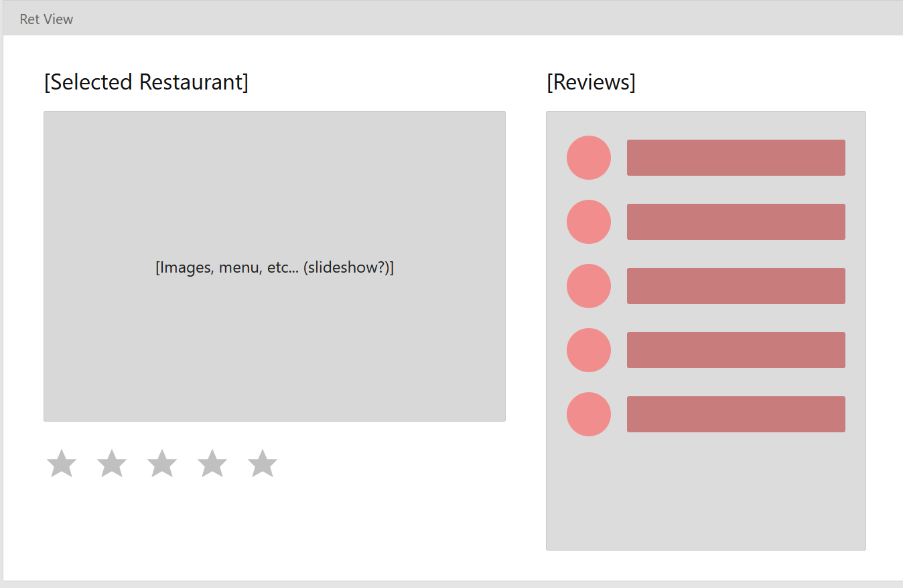
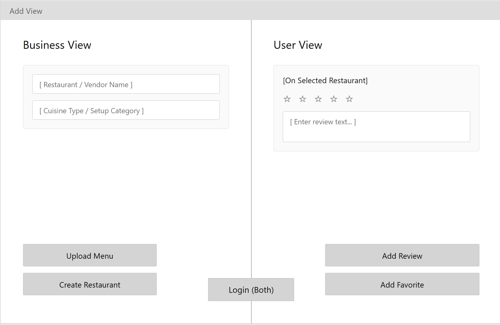
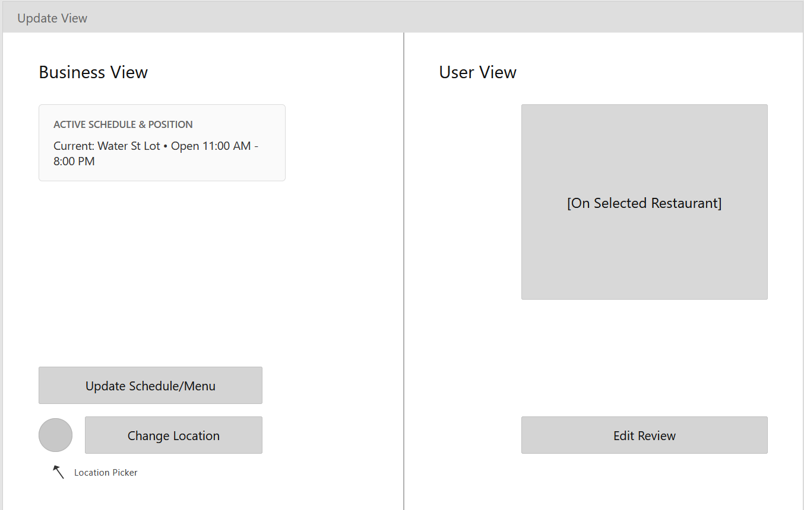
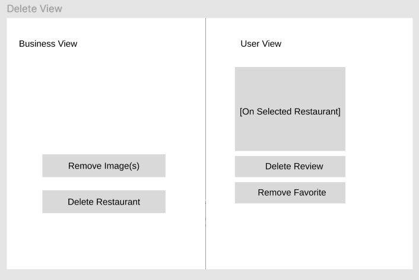
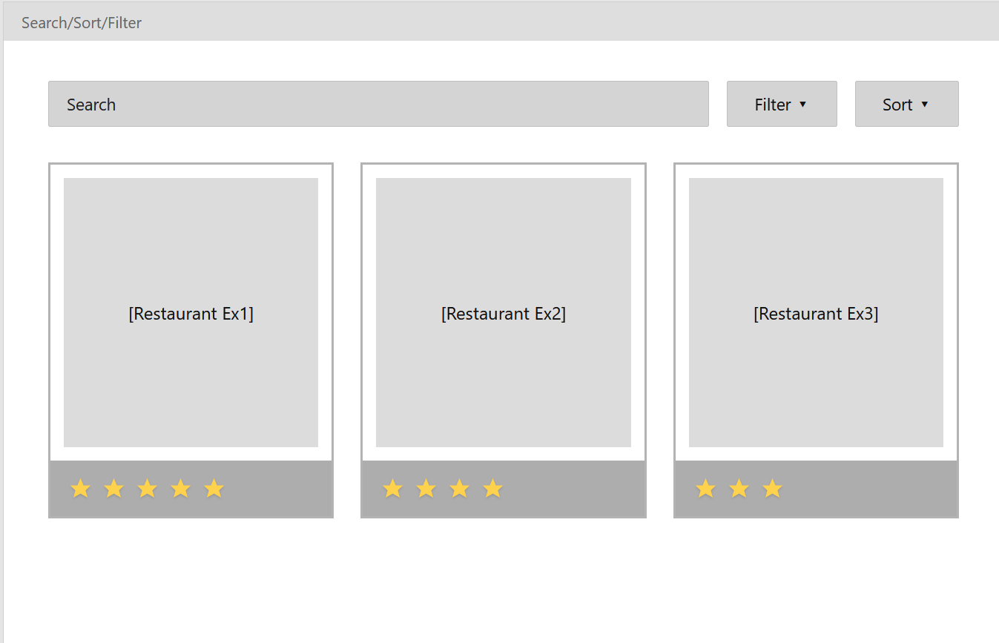
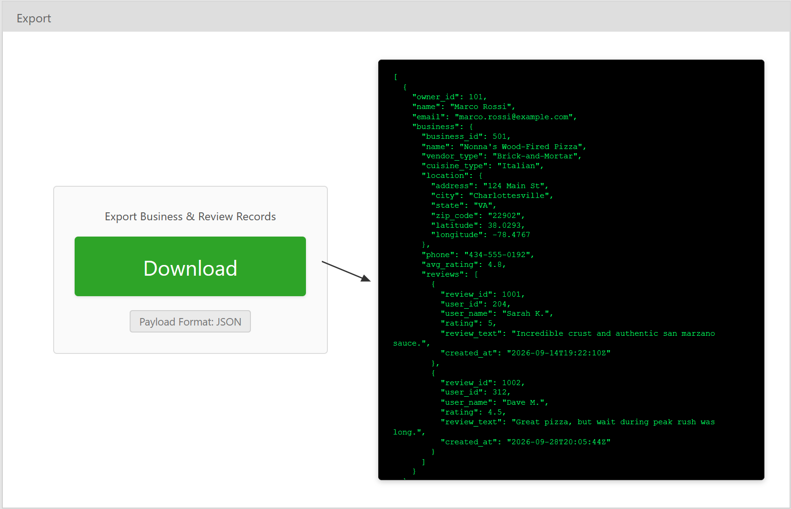
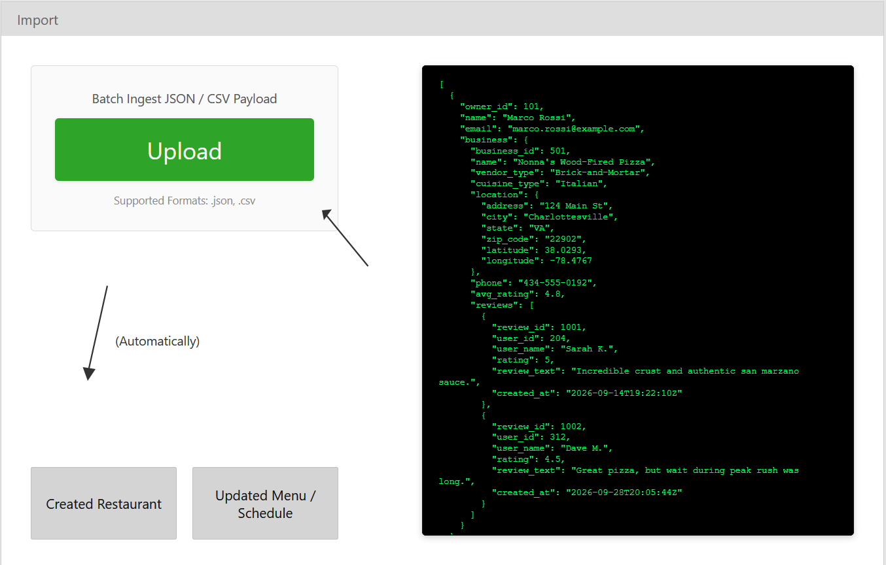

# Part 1:

## Clearly explain your project concept:

Our project is a food discovery and management platform backed by a relational MySQL database. The database stores core establishment details, including name, address, city, state, zip code, phone number, website, cuisine classification, and ratings. To build a transparent trust layer, our schema extends beyond simple average scores to store individual user reviews as distinct records, allowing each vendor to link to multiple community reviews. Users can browse, search, and filter listings, contribute their own entries and reviews, and manage their data over time.

Beyond standard in person dining, our app serves as a dedicated central hub for mobile and non-traditional vendors, such as food trucks, pop-up kitchens, catering setups, and independent cooks who lack a permanent physical storefront.

Mainstream platforms currently fail this micro-vendor market. Facebook Marketplace is built for secondhand physical goods, and its rules restrict service advertising, catering, and prepared perishable food. As a result, mobile cooks often face listing removals and are pushed into disorganized local Facebook Groups where potential customers cannot easily track daily schedules, verify sanitary standards, or view reliable feedback. At the same time, legacy directories like Yelp cater heavily to static addresses and pay-to-play ad models, which bury small operators and struggle to reflect mobile operations.

Our platform bridges this gap with a flexible data model built specifically for mobile commerce. Instead of locking businesses to a single static address, the system supports dynamic, real-time location updates so customers can see exactly where a food truck or pop-up is parked on any given day. By giving micro-vendors a structured profile to showcase menus, post operating hours, and advertise their food without paywalls or algorithmic suppression, our app equips the local community with the search tools and verified review infrastructure needed to discover and validate independent culinary talent.

## Clearly describe your dataset:

Our dataset can come from a few places. We could pull data from the Google Places API or build web scrapers, which our team already knows how to do. But scraping that many spots takes a lot of time, so we want to keep things simple and start small.

Our project focuses on local food discovery, covering regular restaurants as well as food trucks, pop-up kitchens, and catering setups. Public datasets usually have millions of records, but for development, we only plan to pull a small slice maybe around a few thousand places along with their reviews, users, and hours. Starting small makes it way easier to test our table relationships, make sure foreign keys work, and check query speeds before we scale up.

To get this data, we could use the Yelp Open Dataset, specifically using business.json, review.json, and user.json. These files give us the exact pieces we need, such as the business file which covers locations and operating hours, the categories can be split into cuisine tags, and the user and review files set up our community review system. If we need extra map points for food truck spots or pop-up hubs, we can grab coordinate data from OpenStreetMap. We could use a quick Python script with pandas to filter everything down to food spots in one city, clean up the data into CSVs, and load it into our MySQL database. We might also use additional datasets found online as needed.

The main source will be cited as: Yelp Inc., Yelp Open Dataset, available at https://www.yelp.com/dataset. Any extra map data will be cited as: OpenStreetMap Contributors, OpenStreetMap Regional POI Extracts, available at https://planet.openstreetmap.org.

## Clearly describe the functionalities your project will provide:

### Retrieve Data

Users can would be able to retrieve data by being able to view and read restaurants, food trucks, and review records stored in the database, including fetching detailed profiles with current operating hours, locations, menus, and ratings. We could have business and also normal users, and they would be able to retrieve information about their profiles.

### Add Data

Users can insert new data into the database by registering an account, submitting a new food spot or mobile vendor profile, or posting a new review with a rating. They could add photos of food, or the menu.

### Update Data

Users can edit existing database records, such as modifying their own submitted reviews, updating a vendor's contact information, or changing a food truck's current operating location and schedule.

### Delete Data

Users can remove data from the database, including deleting a review they previously authored, removing a saved favorite, or taking down an inactive vendor listing they manage.

### Search, Filter, and Sort Data

Users can search for vendors by name or keyword, filter results by cuisine type, city, or vendor category (e.g., food truck vs. In-person), and sort the returned listings by highest average rating or distance.

### Export Data

Users and business owners can export records directly through the application interface into standard formats like JSON or CSV (bypassing any manual database CLI or phpMyAdmin tools). For example, similar to how the Yelp Open Dataset provides downloadable JSON archives, registered vendor owners can download their full profile data, operating logs, and customer reviews. This allows owners to export their records cleanly and feed them directly into data analysis workflows (such as Python and pandas) for custom metrics, sentiment analysis, or local tracking. Regular users can also export filtered search results or their saved lists in JSON format.

### Import Data

Users and managers can import structured data directly into the database through an in-app file uploader rather than backend admin scripts. For instance, food truck operators or multi-location caterers can upload a CSV or JSON file to bulk-import menu items, update scheduled weekly stops, or migrate an existing food catalog into their profile in one step. The application would parse and validate the incoming file, ensures foreign key relationships remain intact, and commits the records directly into the MySQL database.

# Part 2:

The retrieve view uses a two-panel layout to show the restaurant details and overall ratings on the left side, directly next to a scrollable list of community reviews on the right. This side-by-side setup shows how one business connects to many reviews in the database. It allows users to read about the restaurant and see customer feedback at the exact same time without having to click away to a new screen.

The add view is split right down the middle to separate the business and user roles. The left side has clear input fields for creating a new restaurant, and the right side has a star rating and text box for writing reviews. This split layout perfectly matches the database rules by keeping vendor actions completely separate from customer actions. The clear text boxes also show exactly how users will enter their data.

The update view also keeps the split layout and shows the current active information. It features a special location picker tool for business owners and a pre-filled review form for regular users. The location picker is designed specifically for food trucks, letting owners quickly update their daily locations and hours without having to dig through confusing settings.

The delete view keeps the same two-column layout and highlights how to remove information. It includes a clear popup confirmation prompt that asks users if they are sure before anything is permanently deleted. This popup prevents people from accidentally deleting data, which is an important safety feature, while still keeping the same user permissions as the add and update screens.

The search, sort, and filter view is a discovery screen that features a top navigation bar with a text search and dropdown controls. These controls sit right above a grid of basic restaurant preview cards. Keeping the search tools at the top allows users to easily change their search settings, like filtering by food type or sorting by rating. The card grid design makes it very easy to scan through local food options quickly.

 The export view is a clean dashboard that includes a dropdown menu to choose the file format and a large download button. It also has a preview block showing what the exported data looks like. This design hides the complicated backend tools, giving business owners a simple and friendly way to download their data for their own personal records or data analysis.

 The import view is a drag-and-drop dashboard that clearly shows which file types are supported. It features success indicators and a preview terminal to show the data being uploaded. This creates a smooth visual process for uploading large menus or schedules all at once. It takes complex database actions and turns them into a simple, easy to use interface for the vendors.